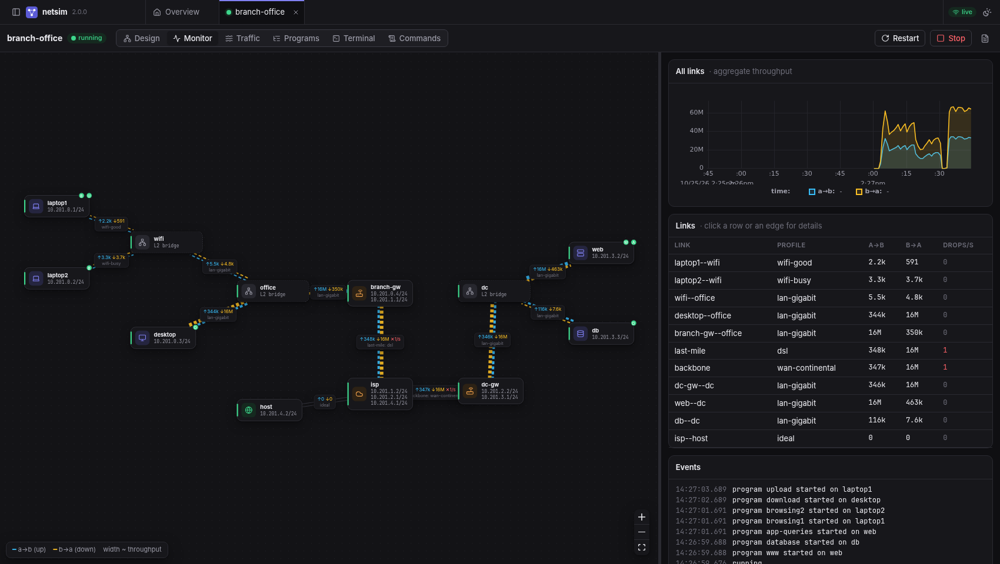
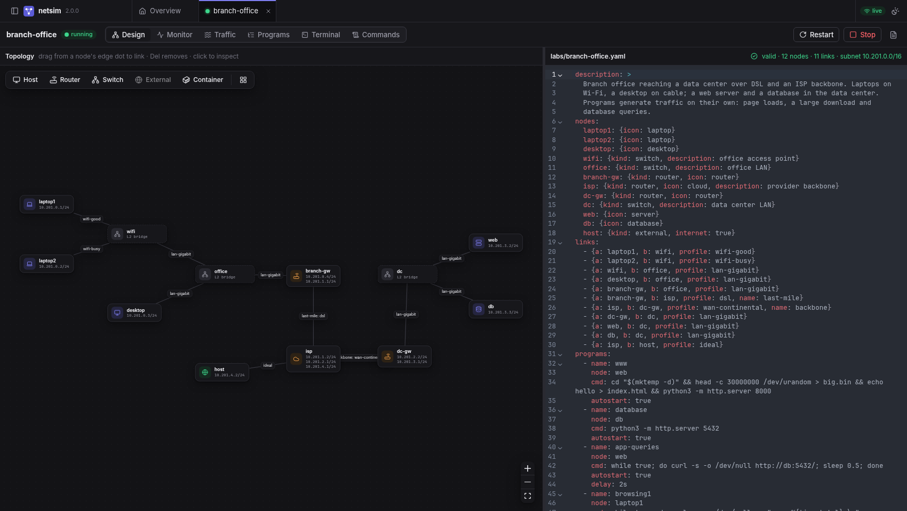
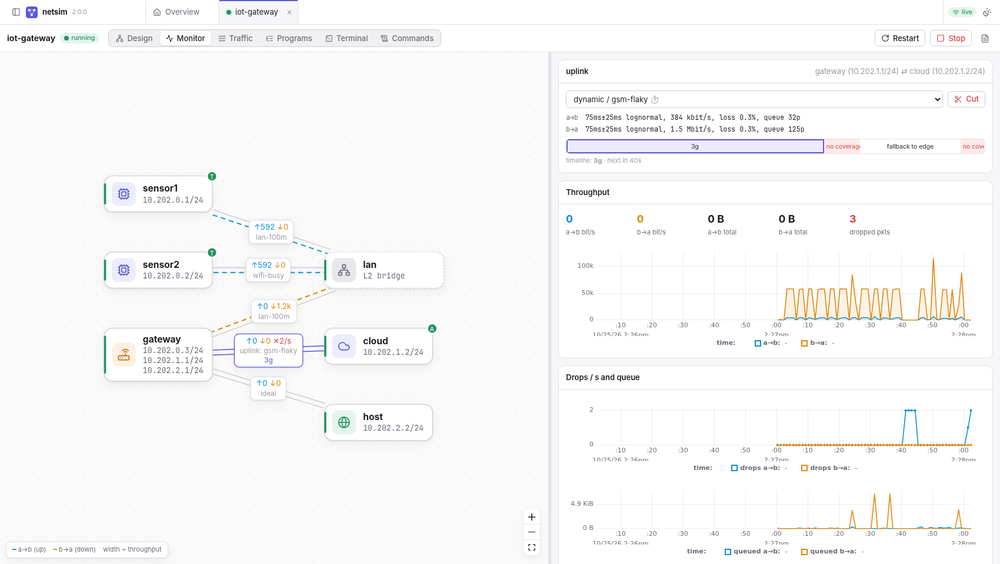
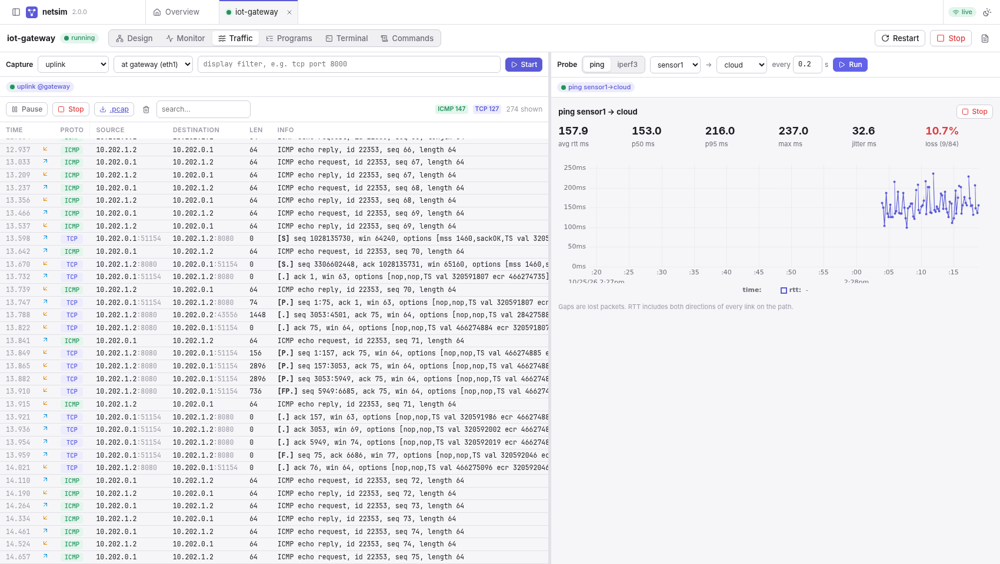
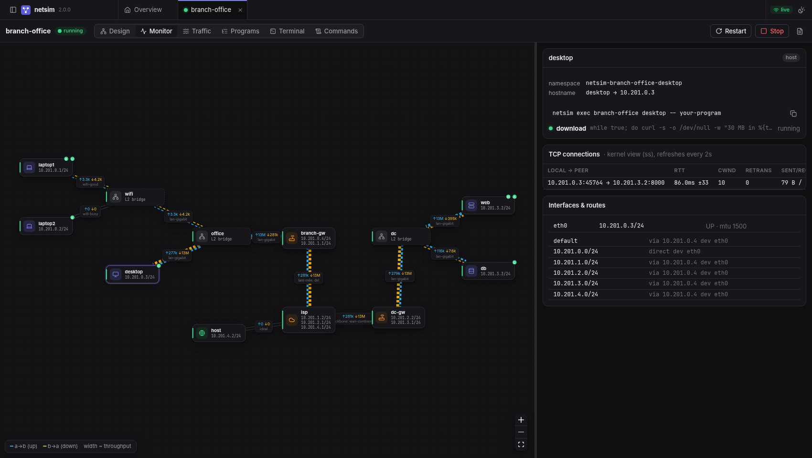
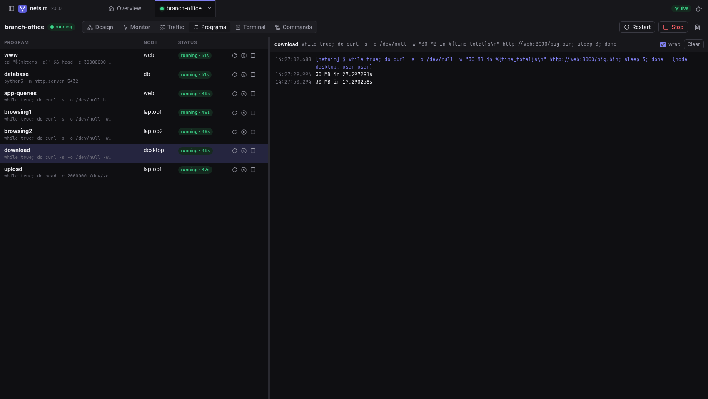
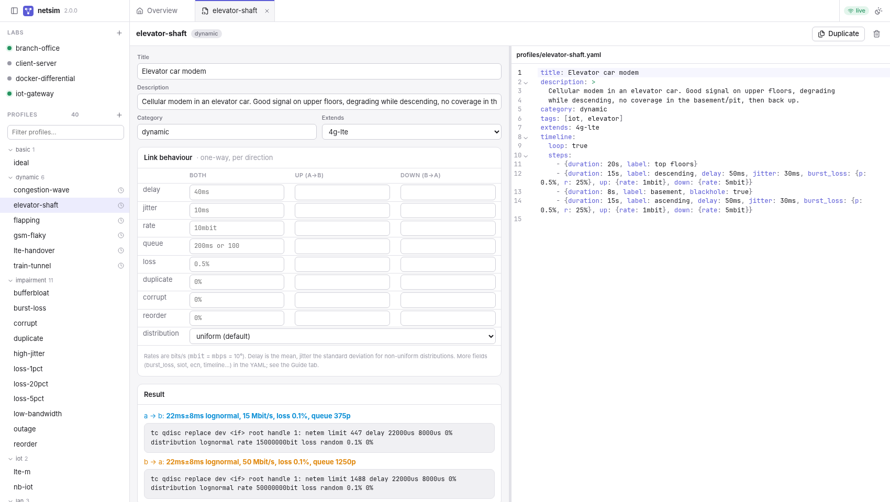
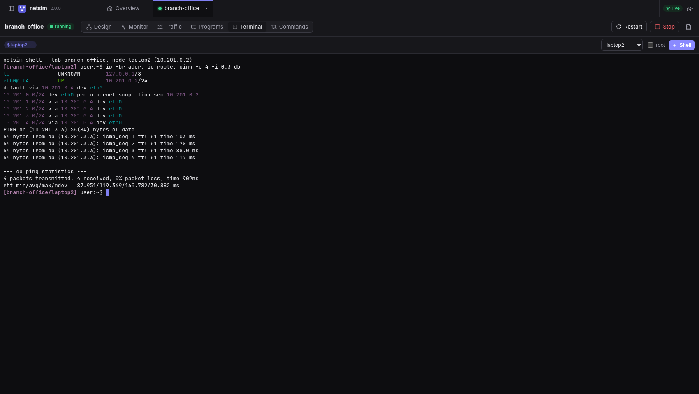
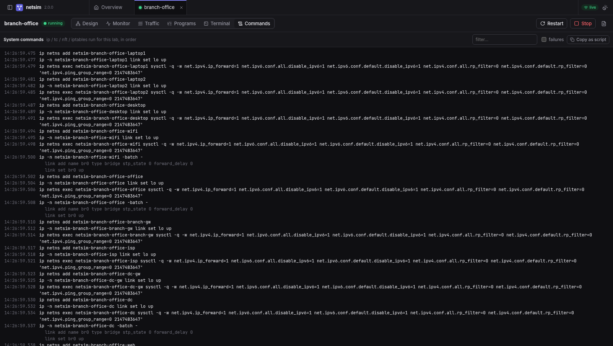

# netsim

Run programs on this machine as if they were on a 3G modem, a busy Wi-Fi, a satellite link or a flaky
cellular uplink - without touching the rest of the machine's traffic.

netsim builds virtual networks ("labs") out of Linux network namespaces and veth pairs, shapes every
link direction with `tc netem`, and gives you a CLI and a web UI to edit topologies, switch link
profiles live, capture packets and watch throughput, loss and latency in real time.



```
netsim run -p 3g-hspa -- curl -sI https://example.com      # one command through a 3G link
netsim pipe 6000:5000 -p edge                              # client :6000 -> EDGE link -> server :5000
netsim up iot-gateway && netsim exec iot-gateway sensor1 -- ./agent
```

Start here: [QUICKSTART.md](QUICKSTART.md) (copy-paste examples) and
[doc/MANUAL.md](doc/MANUAL.md) (step by step guide).

## Requirements

- Linux with `ip`/`tc` (iproute2), `nft`, `sudo`. Optional: `iptables` (hosts running Docker),
  `tcpdump` (packet summaries), `iperf3` and `ping` (probes), `docker`/`podman` (container nodes).
- Python 3.12+, Node 20.19+ (or 22.12+) to build the web UI.
- Root, via sudo. netsim elevates itself when needed and runs your programs as your own user.

## Install

Just trying it: `./run.sh` (builds what is missing, starts the daemon in the background, prints the
UI link; `./run.sh stop|status|logs|build`) and follow [QUICKSTART.md](QUICKSTART.md).

To keep it:

```sh
make install          # builds the UI and installs `netsim` for your user (uv or pipx, editable)
netsim serve --open   # starts the daemon (asks for sudo) and opens the UI
```

Other targets: `make serve` (run from a local venv), `make service` (systemd unit, starts on boot),
`make dev` (UI with hot reload), `make test`, `make dist` (wheel + sdist with UI and the YAML
library, tested in a clean venv).

`netsim doctor` checks tools, kernel support and setup. Only one daemon runs per machine; a second
`netsim serve` refuses and changes nothing.

Installed copies (not a checkout) keep profiles and labs in `~/.config/netsim`, seeded with the
examples on first start. Existing files are never overwritten.

Profiles and labs are plain YAML under `profiles/` and `labs/` of this checkout (or `$NETSIM_HOME`,
or `~/.config/netsim` for non-editable installs).

## Getting a program's traffic through the simulator

| You have | Do |
|---|---|
| A command (curl, ping, a test suite, a shell) | `netsim run -p PROFILE -- CMD`. CMD and all its children only have a shaped link to this machine (and through it, the internet, local services and Docker). |
| A local client that talks to `localhost:PORT` | `netsim run -p PROFILE --forward PORT -- client`: `localhost:PORT` inside reaches the host's `PORT` through the link. Local HTTP proxies in your environment are forwarded automatically. |
| A client and a server you can't change | `netsim pipe LISTEN:TARGET -p PROFILE`, point the client at LISTEN. Only that conversation is shaped. |
| A server in Docker / compose | Reach its published port as `host:PORT` from `netsim run`, or add it to a lab as `kind: container` so clients in other nodes reach it through shaped links. |
| A whole scenario (LAN + gateway + uplink + cloud) | Write a lab, `netsim up LAB`, run things with `netsim exec LAB NODE -- CMD` or `programs:` in the lab. |

Every `run` and `pipe` is its own temporary lab, so several can run side by side - e.g. the same client
over 3G and over Ethernet hitting the same container:

```sh
netsim run -p lan-gigabit -- ./bench http://host:8080 &
netsim run -p 3g-hspa     -- ./bench http://host:8080 &
```

A process that is already running cannot be moved into another network namespace (a kernel rule);
restart it under `netsim run`/`exec`, or put a `pipe` in front of it.

## Labs

```yaml
# labs/iot-gateway.yaml
description: Two sensors on a LAN behind a gateway with a flaky cellular uplink
nodes:
  sensor1: {icon: iot}
  sensor2: {icon: iot}
  lan: {kind: switch}
  gateway: {kind: router}
  cloud: {icon: cloud}
  host: {kind: external, internet: true}     # this machine; NAT to the internet
links:
  - {a: sensor1, b: lan, profile: lan-100m}
  - {a: sensor2, b: lan, profile: wifi-busy}
  - {a: gateway, b: lan, profile: lan-100m}
  - {a: gateway, b: cloud, profile: gsm-flaky, name: uplink}
  - {a: gateway, b: host, profile: ideal}
programs:
  - {name: api, node: cloud, cmd: python3 -m http.server 8080, autostart: true, restart: on-failure}
```

- **Node kinds**: `host` (default), `router` (same as host, drawn differently), `switch` (L2 bridge;
  switches linked together form one segment), `external` (this machine, at most one per lab),
  `container` (attach a running Docker/Podman container: `container: NAME`).
- **Links** are bidirectional; `up` is a→b and `down` is b→a. Put the device/client as `a`.
  Any profile field on a link overrides the profile (`delay: 5ms`, `up: {rate: 1mbit}`).
- **Addressing** is automatic: one /24 per segment from a free `10.N.0.0/16`. Override with
  `subnet` on the lab, a link or a switch, or `ip_a`/`ip_b` on a link. Routes are computed for every
  node; nodes with an `external` node get a default route toward it.
- **Names**: inside the lab every node resolves the others by name (`curl http://cloud:8080`).
- **Programs** run inside their node as you (`user: root` if needed), with output in the UI and
  `netsim logs LAB PROGRAM -f`. Fields: `cmd`, `autostart`, `restart` (no / on-failure / always),
  `delay`, `cwd`, `env`, `user`.
- **Proxies** relay one TCP/UDP endpoint through the lab:
  `{name, proto, listen, listen_node, target, target_node, via: [entry, exit]}`. The default
  listen/target namespace is this machine.
- Labs with an `external` node can reach each other through the host.

Bundled examples: `client-server`, `iot-gateway`, `branch-office`, `docker-differential`.

## Profiles

```yaml
# profiles/4g-lte-poor.yaml
title: 4G LTE (poor signal)
category: mobile
delay: 50ms               # one-way mean; RTT ~ 2x
jitter: 30ms              # std-dev for non-uniform distributions
distribution: lognormal
burst_loss: {p: 0.5%, r: 25%}
queue: 1s                 # bottleneck buffer at link rate
up: {rate: 1mbit}
down: {rate: 5mbit}
```

| Field | Meaning |
|---|---|
| `delay`, `jitter`, `delay_correlation` | one-way delay, variation, correlation |
| `distribution` | `uniform`, `normal`, `pareto`, `paretonormal`, `exponential`, `lognormal`, `weibull` |
| `preserve_order` | keep FIFO order despite jitter (default `true`) |
| `rate` | bits/s: `64kbit`, `5mbit`, `1gbit` (`mbps` means megabits, unlike tc) |
| `queue` | buffer as time at link rate (`300ms`) or packets (`100`); large = bufferbloat |
| `loss`, `loss_correlation` | random loss |
| `burst_loss` | Gilbert-Elliott: `p` good→bad, `r` bad→good, `bad_loss`, `good_loss` |
| `corrupt`, `duplicate`, `reorder` (+ `_correlation`, `reorder_gap`) | other impairments |
| `slot` | deliver in bursts like Wi-Fi/LTE scheduling: `{min, max, packets, bytes}` |
| `ecn`, `blackhole` | mark instead of drop / drop everything |
| `up`, `down` | per-direction overrides |
| `extends` | inherit another profile |
| `timeline` | `{loop, steps: [{duration, label, ...fields}]}` time-varying behaviour |

Shipped (`netsim profiles`): `ideal`; LAN `lan-gigabit`, `lan-100m`, `lan-congested`; Wi-Fi
`wifi-good`, `wifi-busy`, `wifi-edge`; cellular `gprs`, `edge`, `3g-umts`, `3g-hspa`, `4g-lte`,
`4g-lte-poor`, `5g-nr`; IoT `lte-m`, `nb-iot`; satellite `satellite-geo`, `satellite-leo`; WAN `dsl`,
`cable`, `fiber`, `wan-continental`, `wan-intercontinental`; impairments `bufferbloat`,
`low-bandwidth`, `loss-1pct`, `loss-5pct`, `loss-20pct`, `burst-loss`, `reorder`, `duplicate`,
`corrupt`, `high-jitter`, `outage`; time-varying `flapping`, `gsm-flaky`, `lte-handover`,
`train-tunnel`, `elevator-shaft`, `congestion-wave`.

`netsim profile NAME` prints the exact netem commands a profile produces.

## Web UI

`netsim serve` prints the URL with a login token when run in a terminal; `netsim ui` prints and
opens it at any time. The token is never written to logs.

- **Design**: graph editor and YAML editor side by side, editing the same file (comments survive).
  Drag from a node's edge dot to link, Del to remove, inspector for nodes/links, live validation with
  resolved addresses.
- **Monitor**: live graph (each direction drawn separately, width ~ throughput), per-link charts for
  throughput, drops and queue, timeline position, live profile switch / overrides / cut; per-node
  TCP connections (RTT, cwnd, retransmissions), listening sockets, routes.
- **Traffic**: packet capture on any link end with live decoding and `.pcap` download; ping and
  iperf3 probes between nodes.
- **Programs**, **Terminal** (shell inside any node), **Commands** (every `ip`/`tc`/`nft` command
  netsim ran, copyable as a script).
- Profiles: form + YAML, netem preview per direction, delay histogram, timeline view.
- Tabs, dark/light/system theme.

| | |
|---|---|
|  Design: graph and YAML side by side |  Link details, timeline and live controls |
|  Packet capture and ping probe |  TCP connections as the kernel sees them |
|  Program output |  Profile editor |
|  Shell inside a node |  Every command netsim ran |

## CLI

| Command | |
|---|---|
| `netsim serve [--host H] [--port P] [--user U] [--open]` | daemon + UI (127.0.0.1:8077) |
| `netsim ui` | open the UI of the running daemon |
| `netsim labs` / `profiles [-c CAT]` / `profile NAME` | list / inspect |
| `netsim up LAB` / `down LAB\|--all` / `restart LAB` / `status [LAB]` | lifecycle |
| `netsim run -p PROFILE [-f PORT[:HOSTPORT]] [--delay ..] -- CMD` | one command through a shaped link |
| `netsim pipe LISTEN:TARGET -p PROFILE [--udp]` | shape one client/server conversation |
| `netsim exec LAB NODE [--root] [-- CMD]` | run inside a node (default: your shell); everything after `--` is the command |
| `netsim shape LAB LINK [-p PROFILE] [-d up\|down\|both] [--delay ..] [--reset]` | live link change |
| `netsim cut LAB LINK` / `heal LAB LINK` | drop everything / restore |
| `netsim logs LAB PROGRAM [-f]` | program output |
| `netsim validate FILE` | check a YAML file without the daemon |
| `netsim cleanup` | remove leftovers of a crashed daemon (works with the daemon stopped) |
| `netsim doctor` | check tools, kernel support and setup |

## What netsim changes on the host

While a lab runs: network namespaces `netsim-*` (and `/etc/netns/netsim-*` for per-node `hosts`,
`resolv.conf`, `nsswitch.conf`). Labs with an `external` node also add host-side `nsx*` interfaces
and routes to the lab subnets, set `net.ipv4.ip_forward=1`, add an nft table `netsim_<id>` (NAT and
forwarding policy) and, if iptables is present, `FORWARD` accept rules tagged `netsim:<id>` (Docker
sets `FORWARD` to DROP). Container nodes get `sim*` interfaces inside the container. Everything is
removed when the lab stops or the daemon exits, and `netsim cleanup` (also run at daemon start)
removes leftovers. `ip_forward` is left enabled.

The daemon runs as root and can start programs, so its API requires the token in `/run/netsim/token`
(readable only by you) and only answers on localhost unless `--host` says otherwise.

## Caveats

- netem shapes egress, so each direction is shaped on its sending interface; delays are one-way.
- `pipe`/`--forward`/proxies terminate TCP: loss causes retransmissions on the shaped hop, which is
  what the application sees, but the two end sockets never see the lost segments.
- With `rate`, jitter cannot reorder packets; set `preserve_order: false` (and no rate) to allow it.
- Nodes have IPv6 disabled to keep captures readable.
- Profiles are realistic approximations, not measurements of a specific network.

## Development

```
netsim/            python package: models, shaping, topology, engine, server, cli
  web/             built UI (generated by `make web`)
profiles/ labs/    YAML library and examples
doc/               manual and screenshots
web/               React + TypeScript UI (Vite, React Flow, CodeMirror, uPlot, xterm.js)
tests/             unit tests (no root needed)
contrib/           systemd unit
```

`make test` runs the unit tests. With a daemon running, `make dev` serves the UI with hot reload.

## License

netsim is free software, licensed under the GNU Lesser General Public License v3.0 or later
([COPYING.LESSER](COPYING.LESSER), which builds on the GPL v3 in [COPYING](COPYING)).
Contributions: [CONTRIBUTING.md](CONTRIBUTING.md). Security: [SECURITY.md](SECURITY.md).
