# netsim manual

1. [What netsim does](#1-what-netsim-does)
2. [Install and start](#2-install-and-start)
3. [Your first shaped command](#3-your-first-shaped-command)
4. [Profiles](#4-profiles)
5. [Labs](#5-labs)
6. [Putting your programs on the network](#6-putting-your-programs-on-the-network)
7. [The web UI](#7-the-web-ui)
8. [Watching and measuring](#8-watching-and-measuring)
9. [Changing a running network](#9-changing-a-running-network)
10. [Docker](#10-docker)
11. [Recipes](#11-recipes)
12. [How it works](#12-how-it-works)
13. [Troubleshooting](#13-troubleshooting)
14. [Reference](#14-reference)

---

## 1. What netsim does

Your program works on your desk. Then it runs on a 3G modem, a crowded Wi-Fi or a satellite link,
and it breaks. netsim lets you see that on your own machine, before it happens in the field.

It does three things:

- It builds small virtual networks on your Linux machine. A network is called a **lab**.
- It makes each link in the lab behave like a real one: delay, jitter, loss, limited bandwidth,
  full buffers, outages. A link's behaviour is called a **profile**.
- It puts your programs inside the lab, so their traffic crosses those links. Nothing else on the
  machine is affected.

You drive it from the terminal (`netsim ...`) or from a web page.

---

## 2. Install and start

You need Linux, `sudo`, Python 3.12 or newer, and Node.js 20.19 or newer (to build the web page).
`ip`, `tc` and `nft` come with most distributions. `tcpdump`, `iperf3` and `docker` are optional.

Clone the repository and start it:

```sh
./run.sh
```

The first time it builds everything. This takes a minute. Then it starts the netsim daemon in the
background. It asks for your sudo password, because building networks needs root.

At the end it prints a link like this:

```
  Web UI   http://127.0.0.1:8077/?token=k2hrJqCA...
```

Open it in your browser. Keep the terminal for the next chapter.

Make the `netsim` command available in this shell:

```sh
export PATH="$PWD/.venv/bin:$PATH"
netsim --help
```

Useful `run.sh` commands:

| Command | Does |
|---|---|
| `./run.sh` | build if needed, start, print the link |
| `./run.sh status` | is it running? what labs are up? the link again |
| `./run.sh stop` | stop the daemon and remove every lab |
| `./run.sh logs` | follow the daemon log |

To install `netsim` for good, use `make install` instead. See the README.

---

## 3. Your first shaped command

Run the same download twice, on two different networks:

```sh
netsim run -p ideal   -- curl -so /dev/null -w '%{time_total}s\n' https://example.com
netsim run -p 3g-umts -- curl -so /dev/null -w '%{time_total}s\n' https://example.com
```

The second one is slower. That is the whole idea.

What happened:

1. `netsim run` created a tiny temporary lab with one node, `app`.
2. `app` is connected to your machine through one link with the `3g-umts` profile.
3. `curl` ran inside `app`, as your user. Its only way out was that link.
4. When `curl` exited, the lab was removed.

netsim prints a short header before the command:

```
netsim: lab run-48211 · profile 3g-umts · this machine is 'host' (10.201.0.2)
netsim:   out 75ms±25ms lognormal, 384 kbit/s, loss 0.3%, queue 32p
netsim:   in  75ms±25ms lognormal, 1.5 Mbit/s, loss 0.3%, queue 125p
```

`out` is traffic leaving your program. `in` is traffic coming back. Add `-q` to hide the header.

You can run a whole shell this way. Everything you start inside it uses the link:

```sh
netsim run -p satellite-geo -- bash
ping -c 3 1.1.1.1          # about 600 ms
exit
```

---

## 4. Profiles

A profile describes one link. It is a YAML file in `profiles/`.

### 4.1 Look at the shipped profiles

```sh
netsim profiles
netsim profiles -c mobile
netsim profile 4g-lte
```

The last command prints the file and the exact `tc` commands netsim will run for it.

There are 40 profiles: LAN, Wi-Fi, 2G to 5G, LTE-M and NB-IoT, satellites, home broadband, long
distance WAN, pure impairments (loss, reorder, duplicates, outage) and time-varying scenarios.

### 4.2 Read a profile

```yaml
# profiles/4g-lte-poor.yaml
title: 4G LTE (poor signal)
category: mobile
delay: 50ms
jitter: 30ms
distribution: lognormal
burst_loss: {p: 0.5%, r: 25%}
queue: 1s
up: {rate: 1mbit}
down: {rate: 5mbit}
```

Line by line:

- `delay: 50ms` - every packet waits 50 ms on average. This is **one way**. A ping crosses the
  link twice, so expect about 100 ms.
- `jitter: 30ms` - the delay varies. For `lognormal` this is the standard deviation.
- `distribution: lognormal` - the shape of the variation. Most packets are close to 50 ms, a few
  are much later. Real radio links look like this.
- `burst_loss` - packets are lost in bursts, not one by one. More on this below.
- `queue: 1s` - the buffer in front of the bottleneck holds one second of traffic.
- `up` and `down` - values for each direction. On a link from `a` to `b`, `up` is a→b.
  Put the device or client as `a`. Then `up` means upload.

### 4.3 Units

| Kind | Write | Notes |
|---|---|---|
| time | `250us`, `40ms`, `1.5s` | a bare number means ms |
| rate | `64kbit`, `5mbit`, `1gbit` | always bits per second. `mbps` is megabits too |
| percent | `0.5%`, `20%` | a bare number means percent |
| queue | `300ms` or `100` | time at link rate, or packets |

Careful: plain `tc` reads `mbps` as megabytes. netsim does not. `5mbps` here is 5 megabits.

### 4.4 The fields

Every field is optional. A profile with no fields is a perfect link.

| Field | What it does |
|---|---|
| `delay` | average one-way delay |
| `jitter` | how much the delay varies |
| `distribution` | `uniform`, `normal`, `pareto`, `paretonormal`, `exponential`, `lognormal`, `weibull` |
| `delay_correlation` | how much a packet's delay depends on the previous one |
| `rate` | bandwidth |
| `queue` | buffer size; big buffers give bufferbloat |
| `loss` | random loss |
| `burst_loss` | loss in bursts (see below) |
| `corrupt` | flip one bit in some packets |
| `duplicate` | send some packets twice |
| `reorder` | let some packets overtake others (needs `delay`) |
| `slot` | deliver packets in bursts, like Wi-Fi or LTE scheduling |
| `ecn` | mark packets instead of dropping them |
| `blackhole` | drop everything |
| `preserve_order` | keep packets in order despite jitter (default `true`) |
| `up`, `down` | per-direction overrides |
| `extends` | start from another profile |
| `timeline` | change over time |

**Burst loss.** `burst_loss: {p: 1%, r: 25%}` means: each packet has a 1% chance to enter a bad
state; in the bad state each packet has a 25% chance to leave it. While bad, packets are lost.
On average this loses about 4% of packets, but in runs of several packets. Protocols suffer much
more from this than from 4% random loss. Wireless links lose packets this way.

**Uniform vs other distributions.** With `uniform`, `jitter: 10ms` means anywhere between
delay-10 and delay+10. With the others, jitter is the standard deviation, and some packets go
far beyond it. The profile editor in the web UI draws the result as a histogram.

### 4.5 Write your own profile

Copy one that is close and edit it:

```sh
cp profiles/4g-lte.yaml profiles/my-modem.yaml
```

```yaml
# profiles/my-modem.yaml
title: Our field modem
description: Measured at the north site, March. Bad uplink.
category: custom
extends: 4g-lte
up: {rate: 800kbit}
loss: 1%
```

`extends: 4g-lte` takes everything from `4g-lte` and changes only what you write.

Try it:

```sh
netsim profile my-modem
netsim run -p my-modem -- curl -sI https://example.com
```

If something is wrong, netsim says which field and why. You can also edit profiles in the web UI:
there is a form on the left and the YAML on the right. Both edit the same file.

The form has one row per field and one column per direction. Empty means "not set":

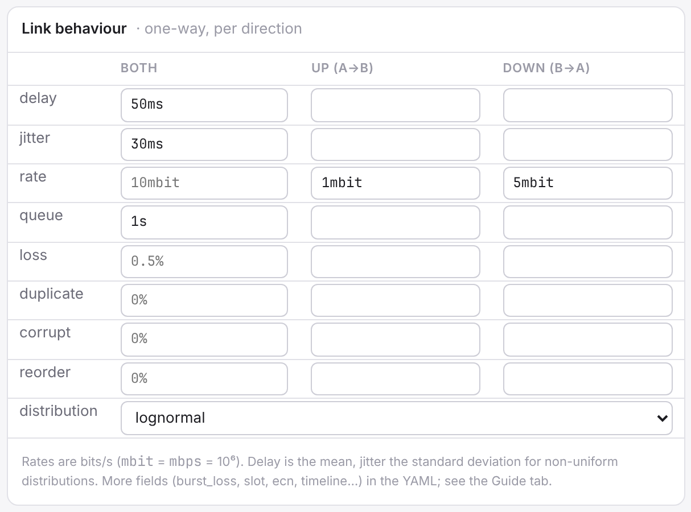

Below it, a histogram shows the delays the profile will produce. Use it to choose a distribution:

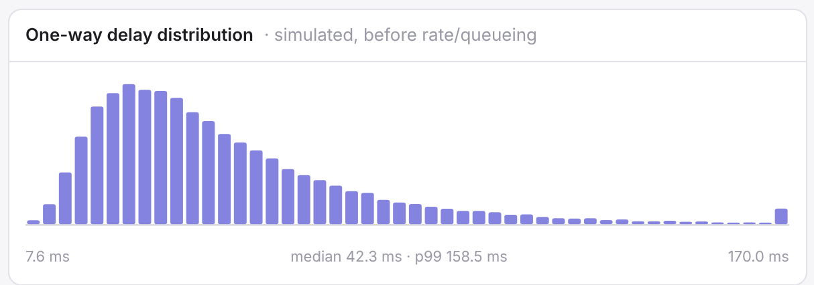

And the result for each direction, with the exact command netsim will run:

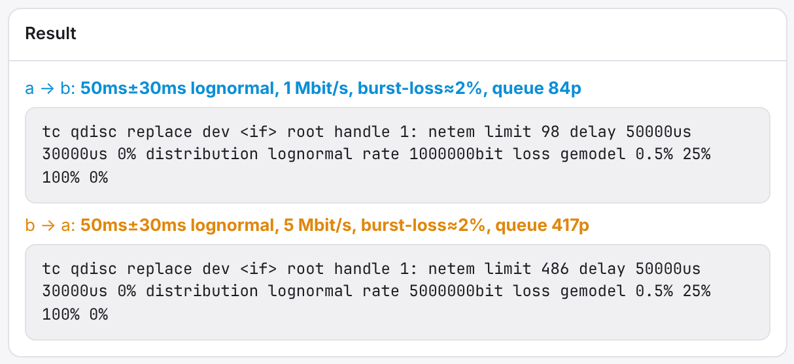

When you save a profile, labs that are running with it pick up the change at once.

### 4.6 Profiles that change over time

Real links are not stable. A timeline runs a list of steps, one after the other:

```yaml
# profiles/flapping.yaml
title: Flapping link
delay: 10ms
timeline:
  loop: true
  steps:
    - {duration: 10s, label: up}
    - {duration: 3s, label: down, blackhole: true}
```

Each step can set any field. Fields not set in a step come from the top of the file.
With `loop: true` the steps repeat forever. With `loop: false` they run once, then the link
goes back to the base values.

The profile editor draws the steps. Red steps drop everything:

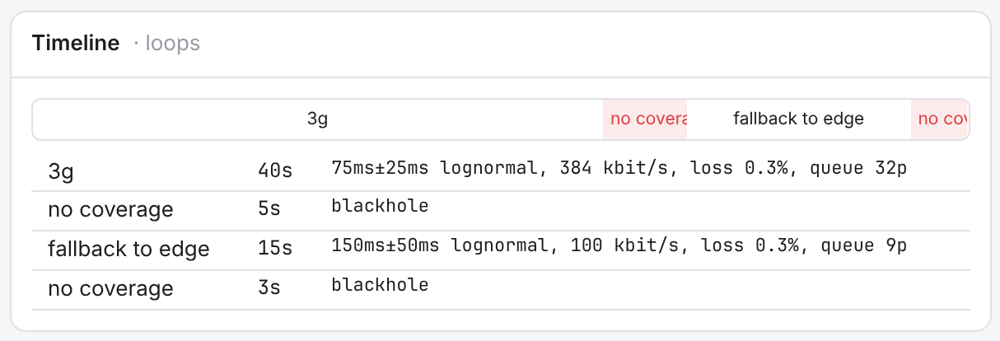

Shipped examples: `flapping`, `gsm-flaky`, `lte-handover`, `train-tunnel`, `elevator-shaft`,
`congestion-wave`, `satellite-leo`.

```sh
netsim run -p gsm-flaky -- ping 1.1.1.1     # watch the outages
```

---

## 5. Labs

`netsim run` is a lab with one node. Real situations need more: a few devices, a router, a slow
uplink, a server. You describe that in a lab file in `labs/`.

### 5.1 The smallest lab

```yaml
# labs/client-server.yaml
nodes:
  client: {}
  server: {}
links:
  - {a: client, b: server, profile: 4g-lte}
```

Start it and use it:

```sh
netsim up client-server
netsim exec client-server client -- ping -c 3 server
netsim exec client-server client           # opens your shell inside 'client'
netsim down client-server
```

Each node is a separate network, like a separate computer. It has its own interfaces, addresses
and routes. Your files and programs are the same as on your machine.

### 5.2 Names and addresses

You don't need to pick addresses. netsim picks a free `10.N.0.0/16` and gives each link its own
`/24`. Every node can reach every other node **by name**: `ping server`, `curl http://web:8000`.

See what it picked:

```sh
netsim status client-server
```

If you need fixed addresses, set them:

```yaml
subnet: 10.50.0.0/16                       # base for the whole lab
links:
  - {a: client, b: server, subnet: 192.168.7.0/24, ip_b: 192.168.7.10/24}
```

### 5.3 Node kinds

| Kind | Use it for |
|---|---|
| `host` (default) | a device, a client, a server |
| `router` | same as host, drawn as a router. Every node forwards packets anyway |
| `switch` | a local network. Everything connected to it shares one subnet |
| `external` | your real machine. Gives the lab access to it, and with `internet: true`, to the internet |
| `container` | a running Docker container (chapter 10) |

`icon: laptop | server | phone | iot | cloud | database | ...` only changes the drawing.

### 5.4 A real example

```yaml
# labs/iot-gateway.yaml (shortened)
nodes:
  sensor1: {icon: iot}
  sensor2: {icon: iot}
  lan: {kind: switch}
  gateway: {kind: router}
  cloud: {icon: cloud}
  host: {kind: external, internet: true}
links:
  - {a: sensor1, b: lan, profile: lan-100m}
  - {a: sensor2, b: lan, profile: wifi-busy}
  - {a: gateway, b: lan, profile: lan-100m}
  - {a: gateway, b: cloud, profile: gsm-flaky, name: uplink}
  - {a: gateway, b: host, profile: ideal}
```

Two sensors share a local network. A gateway connects that network to a cloud server through a
flaky cellular link. The gateway also connects to your machine, so the sensors can reach the
internet.

The routes are computed for you. The sensors send everything through the gateway. The gateway
sends internet traffic to `host`.

Give a link a `name` when you want to refer to it easily. Otherwise its name is `a--b`, for
example `sensor1--lan`.

### 5.5 Override a profile on one link

Any profile field can go on a link. It overrides the profile for that link only:

```yaml
  - {a: gateway, b: cloud, profile: 4g-lte, delay: 80ms, up: {rate: 2mbit}}
```

### 5.6 Programs that start with the lab

```yaml
programs:
  - name: api
    node: cloud
    cmd: python3 -m http.server 8080
    autostart: true
    restart: on-failure
  - name: telemetry
    node: sensor1
    cmd: while true; do curl -s http://cloud:8080/ >/dev/null; sleep 2; done
    autostart: true
    delay: 2s
```

netsim starts them inside their node, as your user, and keeps their output:

```sh
netsim logs iot-gateway telemetry -f
```

`restart` can be `no`, `on-failure` or `always`. `delay` waits before the first start.
`user: root` runs as root. `cwd` and `env` work as expected.

### 5.7 Check a file without starting it

```sh
netsim validate labs/my-lab.yaml
```

It prints the addresses each node would get, or the error.

---

## 6. Putting your programs on the network

Pick the case that matches yours.

**I have a command.** Use `netsim run`. Everything the command starts is included.

```sh
netsim run -p edge -- ./integration-tests.sh
```

**My client talks to `localhost:PORT`.** Inside a node, `localhost` is the node itself. Use
`--forward` to make `localhost:PORT` reach your machine's port, through the shaped link:

```sh
python3 -m http.server 5000 &
netsim run -p 4g-lte-poor --forward 5000 -- curl http://localhost:5000/
```

`--forward 6000:5000` maps port 6000 inside to 5000 outside. `--forward-udp` does the same for UDP.
If your environment has an HTTP proxy on localhost (`HTTPS_PROXY=http://127.0.0.1:...`),
netsim forwards it automatically.

**I can't change the client or the server.** Use `netsim pipe`. It listens on one port and relays
to another, through a shaped link:

```sh
netsim pipe 6000:5000 -p edge          # client connects to :6000, server listens on :5000
```

Only that conversation is shaped. `--udp` for UDP. Ctrl-C removes it.

**I want a program inside a lab node.** Use `netsim exec`, or `programs:` in the lab file.

```sh
netsim exec iot-gateway sensor1 -- ./my-agent --server cloud:8080
```

**The program is already running.** Linux does not allow moving a running process to another
network. Restart it with one of the commands above, or put a `pipe` in front of it.

You can run as many `run` and `pipe` commands at the same time as you want. Each one is its own lab.

---

## 7. The web UI

The link from `./run.sh` opens it. `./run.sh status` prints it again.

The left side lists labs and profiles. Click one to open it in a tab. A green dot means the lab is
running. The theme button is at the top right.

### 7.1 Design


The graph on the left and the YAML on the right are the same file. Change one, the other follows.
Comments in the YAML are kept.

**Add a node** with the buttons on top of the graph:

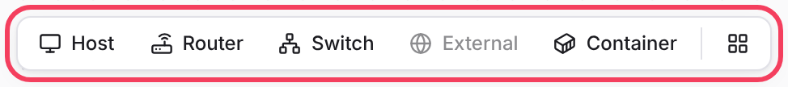

**Link two nodes.** Hover a node. A small dot appears on its right edge. Drag the dot onto the
other node and release:

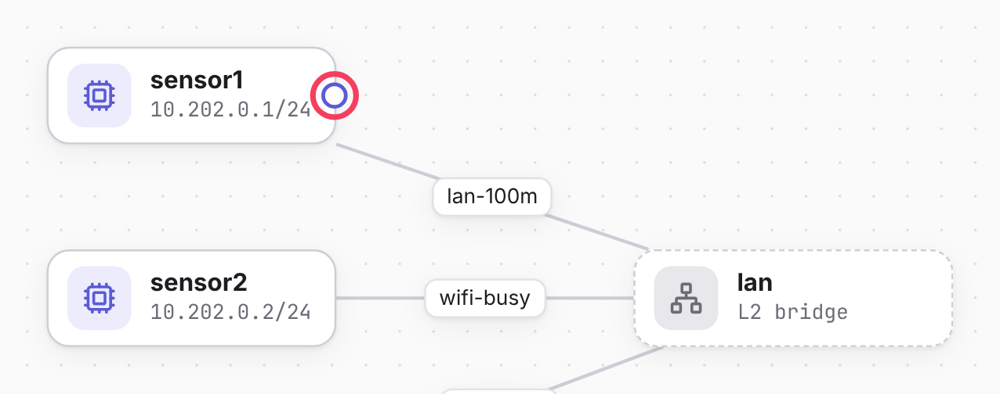

**Edit a node or a link** by clicking it. For a link you pick the profile, add overrides per
direction, and set addresses if you need them:

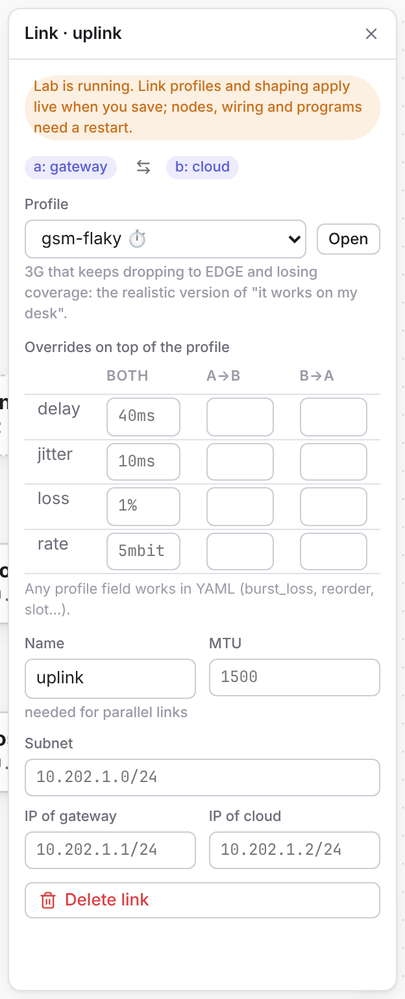

`Del` removes the selection. The last button on the toolbar arranges the graph automatically.

**Errors** show in red above the editor while you type, with the line marked:

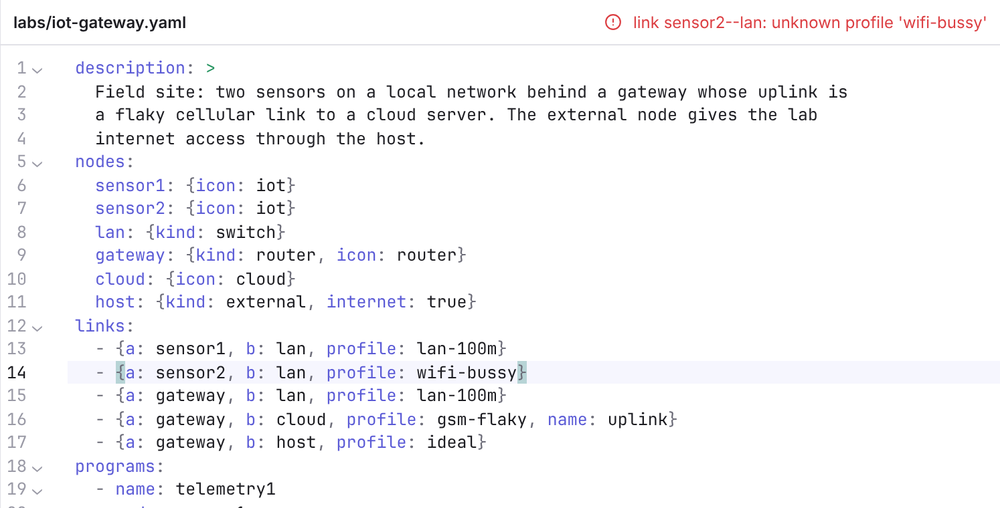

When the file is valid, the graph shows the addresses each node will get. `Ctrl+S` saves.
**Start** saves and starts.

### 7.2 Monitor


This is the running lab. Each link has two lanes: blue for a→b, amber for b→a. A lane gets wider
with more traffic and moves while traffic flows.

The label on a link shows bits per second in each direction, the profile, and the current
timeline step. **Click the label** to control that link:

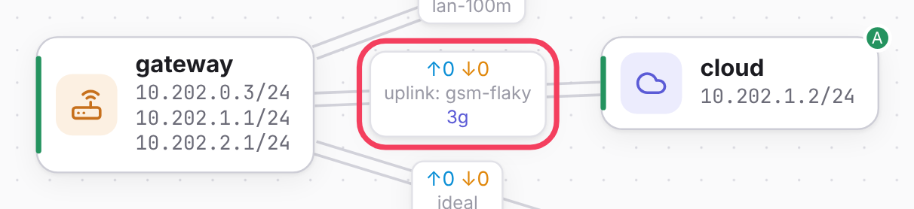

The panel on the right opens. At the top are the controls:

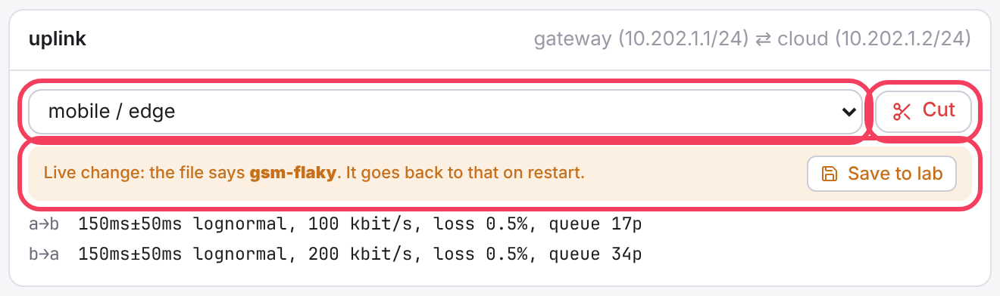

- **The list** switches the profile now. The change is live only: a yellow note tells you what
  the file says. **Save to lab** writes it into the lab file, so it stays after a restart.
- **Cut** drops all traffic. **Heal** brings it back. Picking a profile also brings it back.
- The two lines below show what is applied in each direction.

For a profile with a timeline you also see the steps, the current one framed, and when the next
one starts:

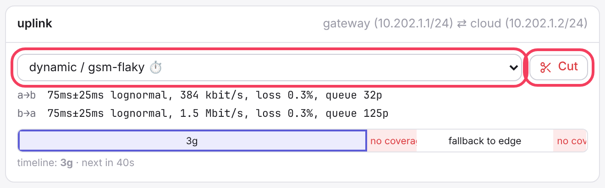

Below come the charts: throughput per direction, drops and queue, for the last minutes.

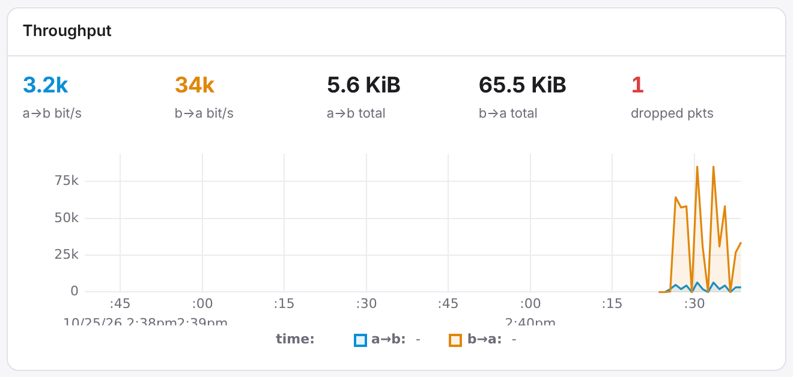

**Live override** changes single values on top of the profile. Pick the direction, type the
values, press **Apply**. Overrides are temporary: switching profile or restarting drops them.

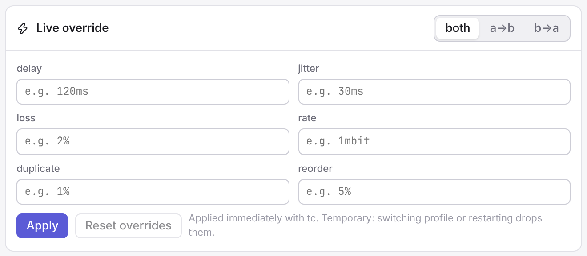

**Click a node** to see what its TCP connections experience: round-trip time, congestion window,
retransmissions, bytes. It refreshes every two seconds. It also lists listening ports and routes.

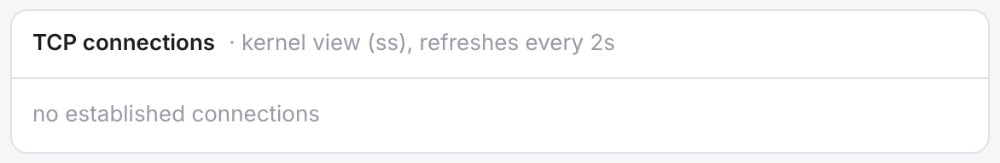

### 7.3 Traffic


**Capture.** Pick a link, pick which end listens, optionally type a filter (`tcp port 8000`), press
**Start**. Packets appear as they pass. The arrow shows if that end sent (↗) or received (↙) the
packet. **.pcap** downloads everything for Wireshark.

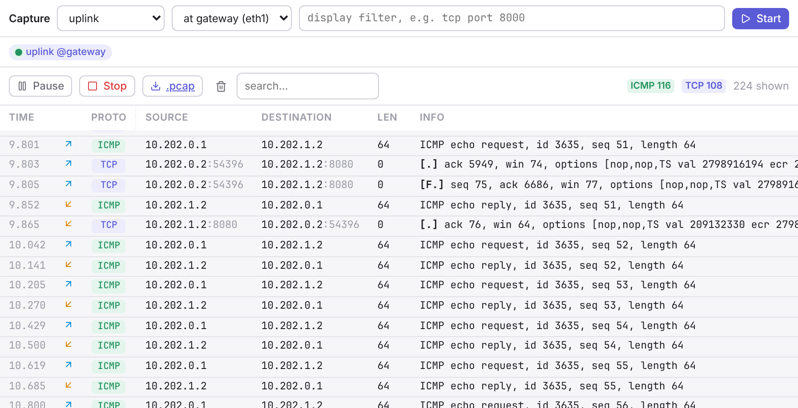

**Probes.** ping measures round-trip time and loss between two nodes. iperf3 measures how much data
really gets through. Use them to check that a link does what you expect. Here a ping crosses the
flaky uplink; the gaps are the outages of the timeline:

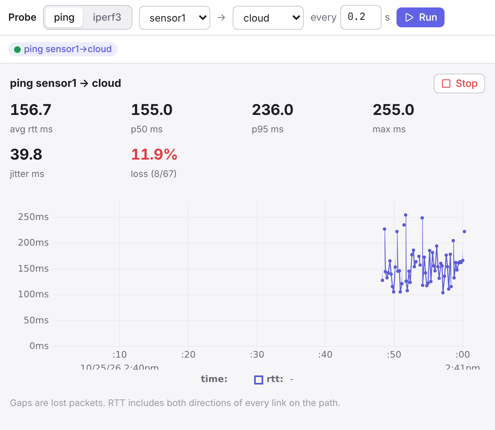

### 7.4 Programs, Terminal, Commands

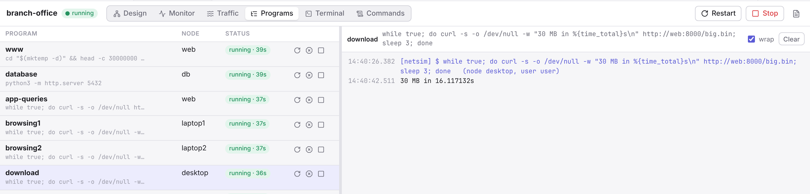

**Programs** lists the lab's programs. Start, stop, restart or send Ctrl-C. The right side shows
the output, live.


**Terminal** opens a shell inside a node, in the browser. Tick **root** for a root shell.

**Commands** lists every system command netsim ran for the lab, in order, with errors.
**Copy as script** gives you a shell script that builds the same network by hand.

---

## 8. Watching and measuring

The same things from the terminal:

```sh
netsim status iot-gateway                                  # nodes, addresses, links, programs
netsim exec iot-gateway sensor1 -- ping -c 20 -i 0.2 cloud # latency and loss
netsim exec iot-gateway cloud -- iperf3 -s -1 -D           # throughput: server...
netsim exec iot-gateway sensor1 -- iperf3 -c cloud -t 10   # ...and client
netsim exec iot-gateway sensor1 -- ss -tin                 # TCP details from the kernel
```

A note on throughput. A link with `rate: 50mbit` does not mean one TCP connection gets 50 Mbit/s.
With delay and loss, TCP slows itself down. With 45 ms round trip and 0.1% loss, one connection
gets about 10 Mbit/s. This is real behaviour, and often the reason a program feels slow.

---

## 9. Changing a running network

You don't need to restart anything to change a link.

```sh
netsim shape iot-gateway uplink -p edge               # switch profile
netsim shape iot-gateway uplink --delay 400ms         # change one value, both directions
netsim shape iot-gateway uplink -d up --rate 64kbit   # one direction only
netsim shape iot-gateway uplink --reset               # drop your overrides
netsim cut   iot-gateway uplink                       # pull the cable
netsim heal  iot-gateway uplink                       # plug it back
```

These changes live in memory. They are gone when the lab stops. Switching profile also drops
earlier overrides, including a cut.

To keep a change, put it in the lab file. In the UI: **Save to lab** on the link panel, or edit
the link in Design and save. You don't need to restart for that. When you save a running lab:

- profile and shaping changes on links apply at once;
- moving nodes, editing descriptions: nothing to apply;
- new nodes, new links, changed addresses, programs or proxies: netsim tells you to restart
  (`netsim restart LAB`). Until then the toolbar shows "file changed · restart to apply".

Saving a profile re-applies it on every running link that uses it.

---

## 10. Docker

### 10.1 Reach a container's published port

A container that publishes a port is reachable as `host:PORT` from `netsim run`:

```sh
docker run -d --rm --name my-api -p 8088:80 nginx:alpine
netsim run -p 3g-hspa -- curl -so /dev/null -w '%{time_total}s\n' http://host:8088/
```

### 10.2 Put the container inside a lab

```yaml
# labs/docker-differential.yaml
nodes:
  client-3g: {icon: phone}
  client-eth: {icon: laptop}
  api: {kind: container, container: my-api}
links:
  - {a: client-3g, b: api, profile: 3g-hspa}
  - {a: client-eth, b: api, profile: lan-gigabit}
```

`container:` is the name or id from `docker ps`. For compose, use the service's container name,
for example `myproject-api-1`. The container must be running before the lab starts.

netsim adds new interfaces to the container. Its normal Docker network keeps working. Clients in
the lab reach it by name:

```sh
netsim up docker-differential
netsim exec docker-differential client-eth -- curl -so /dev/null -w 'eth %{time_total}s\n' http://api/
netsim exec docker-differential client-3g  -- curl -so /dev/null -w '3g  %{time_total}s\n' http://api/
netsim down docker-differential
```

When the lab stops, netsim removes its interfaces from the container. The container keeps running.
You cannot run `programs:` in a container node. Use `docker exec` for that.

---

## 11. Recipes

**Compare two networks for the same test.** Run them side by side:

```sh
netsim run -q -p lan-gigabit -- ./bench &
netsim run -q -p 3g-hspa     -- ./bench &
wait
```

**Test reconnect logic.** Use a flapping link, or cut it yourself:

```sh
netsim run -p flapping -- ./client          # 10 s up, 3 s down, forever
```

**Find timeouts that are too short.** Try `nb-iot` (seconds of latency) or `gprs`.

**See bufferbloat.** Start a big upload and a ping at the same time on `bufferbloat`. The ping
goes from 20 ms to seconds while the upload runs.

**Field devices behind a gateway.** Start `iot-gateway`. Open Monitor. Cut `uplink` and watch
the telemetry programs fail and recover in **Programs**.

**A branch office.** `labs/branch-office.yaml` has Wi-Fi laptops, a wired desktop, DSL, a backbone
and a data center with a web server and a database. Its programs generate page loads, a large
download, an upload and database queries.

```sh
netsim up branch-office
```

---

## 12. How it works

You don't need this to use netsim. It helps when something looks odd.

- Each node is a Linux **network namespace**: a separate network stack with its own interfaces,
  addresses, routes and firewall. Programs in a namespace see only that network.
- Each link is a **veth pair**: two virtual interfaces connected like a cable, one end in each
  node.
- A switch is a Linux **bridge** in its own namespace.
- Shaping is done by **netem** (`tc qdisc ... netem`), on the sending side of each link end. That is
  why each direction can be different. netem holds the packet for its delay, drops some, limits
  the rate, and so on.
- The `external` node is your real machine. netsim adds an interface and routes on your machine
  for that lab, and NAT rules if `internet: true`.
- `pipe`, `--forward` and `proxies:` are small relays inside the daemon. They accept a connection
  on one side and open a new one on the other, through the shaped link.

The daemon runs as root. It starts your programs as your user. Its API needs a token, stored in
`/run/netsim/token`, readable only by you.

What it changes on your machine while labs run, and removes when they stop:

- namespaces named `netsim-*` and files in `/etc/netns/netsim-*`;
- for labs with an `external` node: interfaces `nsx*`, routes to the lab, an nft table
  `netsim_*`, and `iptables FORWARD` rules tagged `netsim` (needed when Docker is installed);
- for container nodes: interfaces `sim*` inside the container.

It also turns on `net.ipv4.ip_forward`, and leaves it on.

---

## 13. Troubleshooting

**Something does not work and you don't know why.** Run `netsim doctor`. It checks the tools,
the kernel support and the setup, and says what to install.

**"netsim daemon is not running".** Run `./run.sh`.

**"another netsim daemon is running".** Only one daemon runs per machine. Use the one that runs
(`netsim ui`), or stop it first (`./run.sh stop`).

**The page says "Not authorized".** The token changed when the daemon restarted. Use the new link
from `netsim ui`, or
from `./run.sh status`.

**A lab does not start.** The error is shown in the UI and in the terminal. Common causes: a
profile name with a typo, a container that is not running, a subnet that overlaps another.
`netsim validate labs/LAB.yaml` checks the file alone.

**A name does not resolve inside a node.** Only node names are added. For other names, the node
needs internet access: connect it to an `external` node with `internet: true`.

**`localhost` does not work inside a node.** That is expected: `localhost` is the node itself.
Use `--forward`, or reach your machine through its external node by name (`host` in `netsim run`).

**Things are left over after a crash.** `netsim cleanup` removes them, also with the daemon
stopped. The daemon also does this
when it starts.

**I want to see exactly what netsim did.** Open the lab's **Commands** tab, or `./run.sh logs`.

---

## 14. Reference

### Commands

| Command | Does |
|---|---|
| `netsim serve [--host H] [--port P] [--user U] [--open]` | run the daemon in the foreground |
| `netsim ui` | open the web UI |
| `netsim labs` | list labs |
| `netsim profiles [-c CATEGORY]` | list profiles |
| `netsim profile NAME` | show a profile and its netem commands |
| `netsim up LAB` / `down LAB` / `down --all` / `restart LAB` | start and stop labs |
| `netsim status [LAB]` | what is running |
| `netsim run -p PROFILE [-f PORT[:HOSTPORT]] [-q] -- CMD` | one command through a shaped link |
| `netsim pipe LISTEN:TARGET -p PROFILE [--udp]` | shape one client/server conversation |
| `netsim exec LAB NODE [--root] [-- CMD]` | run inside a node; everything after `--` is the command |
| `netsim shape LAB LINK [-p P] [-d up\|down\|both] [--delay ..] [--loss ..] [--rate ..] [--reset]` | change a link now |
| `netsim cut LAB LINK` / `heal LAB LINK` | drop all traffic / restore |
| `netsim logs LAB PROGRAM [-f]` | program output |
| `netsim validate FILE` | check a YAML file |
| `netsim cleanup` | remove leftovers (works with the daemon stopped) |
| `netsim doctor` | check tools, kernel support and setup |

`run` and `pipe` also accept `--delay`, `--jitter`, `--loss`, `--rate`, `--queue` and others to
override the profile.

### Lab file

```yaml
description: text
subnet: 10.50.0.0/16                 # optional
nodes:
  NAME:
    kind: host | router | switch | external | container
    icon: laptop                     # drawing only
    internet: true                   # external only
    subnet: 10.60.1.0/24             # switch only
    container: my-api                # container only
    sysctl: {net.ipv4.tcp_congestion_control: bbr}
links:
  - a: NODE
    b: NODE
    name: uplink                     # optional, default a--b
    profile: 4g-lte
    subnet: 192.168.7.0/24           # optional
    ip_a: 192.168.7.1/24             # optional
    ip_b: 192.168.7.2/24             # optional
    mtu: 1400                        # optional
    delay: 80ms                      # any profile field overrides the profile
    up: {rate: 1mbit}
programs:
  - name: NAME
    node: NODE
    cmd: shell command
    autostart: true
    restart: no | on-failure | always
    delay: 2s
    user: root                       # default: you
    cwd: ~/project
    env: {KEY: value}
proxies:
  - name: NAME
    proto: tcp | udp
    listen: 127.0.0.1:6000
    listen_node: NODE                # default: your machine
    target: 127.0.0.1:5000           # host may be a node name
    target_node: NODE                # default: your machine
    via: [ENTRY_NODE, EXIT_NODE]
layout: {}                           # written by the graph editor
```

### Profile file

See the table in [4.4](#44-the-fields). A complete example:

```yaml
title: Example
description: What it models and where the numbers come from.
category: custom
tags: [example]
extends: 4g-lte
delay: 40ms
jitter: 10ms
distribution: normal
delay_correlation: 25%
rate: 10mbit
queue: 200ms
loss: 0.5%
burst_loss: {p: 1%, r: 25%, bad_loss: 100%, good_loss: 0%}
corrupt: 0.1%
duplicate: 0.1%
reorder: 1%
reorder_correlation: 25%
slot: {min: 2ms, max: 8ms, packets: 16}
preserve_order: true
up: {rate: 2mbit}
down: {rate: 20mbit}
timeline:
  loop: true
  steps:
    - {duration: 30s, label: normal}
    - {duration: 5s, label: outage, blackhole: true}
```

`loss` and `burst_loss` exclude each other. The last one set wins.
